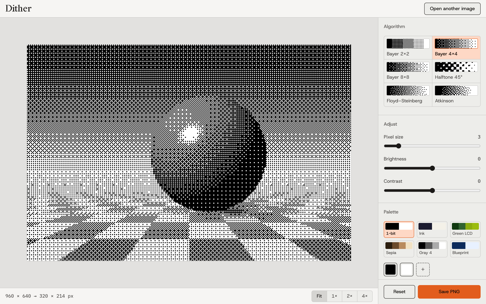
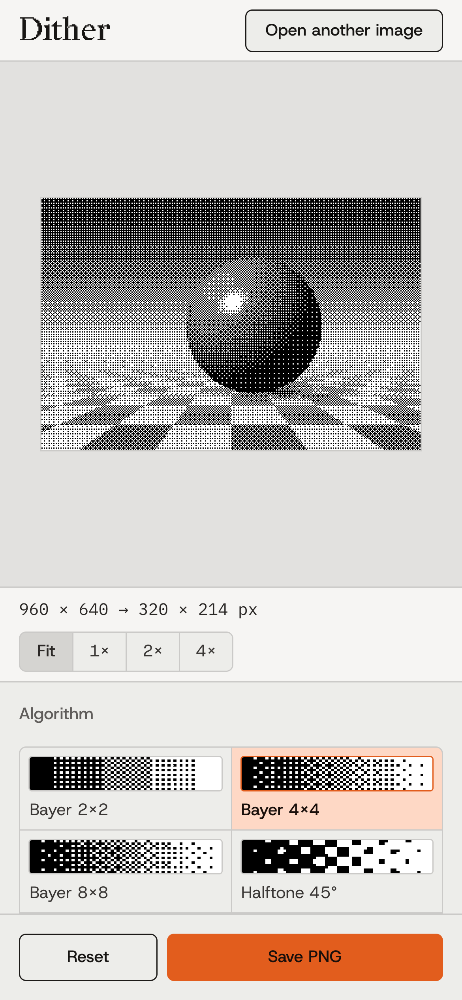

<h1 align="center">Dither</h1>

<p align="center">
  사진을 디더링된 픽셀 이미지로 바꾸고 PNG로 저장하는 웹 앱입니다.<br />
  알고리즘과 팔레트를 고르면 미리보기가 바로 바뀝니다.
</p>

<p align="center">
  
</p>

<p align="center">
  
  
  
  
</p>

## 기능

- **알고리즘 6종**: Bayer 2×2 · 4×4 · 8×8, Halftone 45°, Floyd–Steinberg, Atkinson
- **팔레트 프리셋 6종**: 1-bit, Ink, Green LCD, Sepia, Gray 4, Blueprint. 색은 2개에서 8개까지 직접 추가하거나 바꿀 수 있습니다.
- **조정**: 픽셀 크기(1–16), 밝기, 대비(-100–100)
- **미리보기 배율**: Fit, 1×, 2×, 4×
- **PNG 저장**: 원본 해상도로 업스케일해 `<파일명>-<알고리즘>.png`로 저장합니다.
- **Web Worker 렌더링**: 디더링은 워커에서 실행되므로 슬라이더를 움직여도 UI가 멈추지 않습니다.


## 알고리즘과 팔레트 예시

같은 샘플 이미지에 알고리즘과 팔레트를 다르게 적용한 결과입니다.

<table>
  <tr>
    <td align="center"><br /><sub><b>Bayer 4×4</b> · 1-bit</sub></td>
    <td align="center"><br /><sub><b>Floyd–Steinberg</b> · Ink</sub></td>
    <td align="center"><br /><sub><b>Atkinson</b> · Green LCD</sub></td>
  </tr>
  <tr>
    <td align="center"><br /><sub><b>Halftone 45°</b> · Blueprint</sub></td>
    <td align="center"><br /><sub><b>Bayer 8×8</b> · Sepia</sub></td>
    <td align="center"><br /><sub><b>Bayer 2×2</b> · Gray 4</sub></td>
  </tr>
</table>

## 사용 방법

1. 앱을 열면 샘플 이미지가 바로 표시됩니다. 내 이미지를 쓰려면 **Open another image**를 누르거나 미리보기 영역에 이미지를 끌어다 놓습니다.
2. 오른쪽 패널의 **Algorithm**에서 디더링 방식을 고릅니다. 각 항목의 썸네일은 현재 팔레트로 그린 명암 그라디언트입니다.
3. **Adjust**에서 픽셀 크기, 밝기, 대비를 조절합니다.
4. **Palette**에서 프리셋을 고르거나 색을 직접 편집합니다.
5. **Save PNG**를 눌러 결과를 저장합니다. **Reset**은 모든 설정을 기본값으로 되돌립니다.

<table>
  <tr>
    <td width="68%"></td>
    <td width="32%"></td>
  </tr>
  <tr>
    <td align="center"><sub>데스크톱</sub></td>
    <td align="center"><sub>모바일</sub></td>
  </tr>
</table>

## 로컬에서 실행하기

Node.js와 [pnpm](https://pnpm.io)이 필요합니다.

```bash
pnpm install
pnpm dev        # 개발 서버 (http://localhost:5173)
```

| 명령어 | 설명 |
|---|---|
| `pnpm dev` | Vite 개발 서버를 실행합니다. |
| `pnpm build` | 타입 검사 후 `dist/`에 프로덕션 빌드를 만듭니다. |
| `pnpm preview` | 빌드 결과를 로컬에서 확인합니다. |
| `pnpm test` | Vitest로 디더링 로직 테스트를 실행합니다. |

## 동작 방식

디더링 파이프라인은 `src/lib/dither.ts`에 있는 순수 함수이며 DOM에 접근하지 않습니다. 그래서 Web Worker와 Node(테스트) 양쪽에서 그대로 실행됩니다.

1. 원본을 `pixelSize` 단위 블록으로 평균 내어 축소합니다.
2. Rec.601 가중치로 휘도를 구하고 대비, 밝기 순서로 보정합니다.
3. 팔레트 색 수(N)만큼 균등한 회색 단계로 양자화합니다. Bayer와 Halftone은 순서 임계값(ordered threshold)을, Floyd–Steinberg와 Atkinson은 오차 확산(error diffusion)을 씁니다.
4. 각 단계를 어두운 색부터 밝은 색 순으로 정렬한 팔레트에 대응시킵니다.

결과는 축소된 크기로 나오고, 화면과 PNG 저장 시에는 최근접 이웃(nearest-neighbor) 방식으로 확대합니다. `DitherClient`(`src/lib/ditherClient.ts`)는 한 번에 하나의 렌더만 워커에 보내고, 그사이 들어온 요청은 가장 최신 것만 남깁니다.

```
src/
├── App.tsx                 레이아웃 (헤더 · 미리보기 · 설정 패널)
├── store.ts                옵션 스토어, 팔레트 프리셋, 알고리즘 이름
├── components/             AlgorithmPicker, PalettePresets, ControlPanel, PreviewCanvas, ImageDropzone
├── lib/
│   ├── dither.ts           디더링 파이프라인 (순수 함수)
│   ├── dither.test.ts      파이프라인 테스트
│   ├── ditherClient.ts     워커 래퍼
│   ├── canvas.ts           업스케일, PNG 저장
│   └── sample.ts           절차적으로 생성하는 샘플 이미지
└── workers/dither.worker.ts
```
